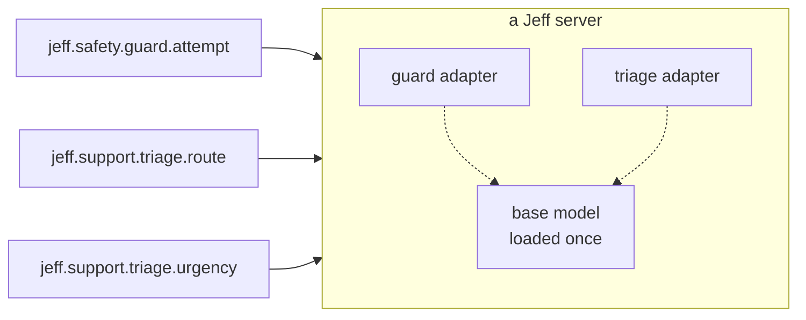

# Adapters

Adapters are central to Jeff. A small **base** model is loaded once, and each **adapter** adds the weights for a particular area:
one adapter checks text for prompt injection, another routes support messages, another reads contract clauses. Each
adapter has one or more **functions**, and a call names the function it wants, so one server can run functions from many
adapters side by side.

## What an adapter is

An adapter is a LoRA ("low-rank adaptation"): a small set of extra weights that adjusts the base model, plus the
adapter's own answer readout. It is much smaller than the base, and many adapters share one copy of the base in
memory.

Every adapter is described by a **manifest**, which is what its catalogue page shows:

- its ID, aliases and version;
- its **context** fields (what stays the same across calls) and its **input** field (what changes per call), each
  with a description of what to put in it; see [State](/docs/guides/state);
- its functions, each with its interface, its instructions exactly as used in training, its labels and its
  calibration: the threshold below which its decisions abstain, and the precision and coverage measured at that
  threshold;
- for an open adapter, where to find its weights and published test set.

## IDs, aliases and versions

Adapter IDs are dotted and namespaced, `jeff.<area>.<name>`, for example `jeff.safety.guard`; a function ID adds the
function's key, `jeff.safety.guard.attempt`. Many adapters also have a short alias (`guard`), so `guard.attempt`
names the same function. An adapter whose ID carries the base it was trained for, such as `jeff.routing.router-open-v14`,
also answers to that ID without the version (`jeff.routing.router-open`): use that name to keep your code unchanged
across base releases, or the versioned ID to pin one base (see [Pinning a version](/docs/guides/decide#section-pinning-a-version)).
Versions follow semantic versioning: the major version changes when a function's labels,
context or meaning change. A reference may pin a version, for example `jeff.safety.guard.attempt@1.4`.

A malformed reference is rejected with `InvalidReference`; an unrecognised reference with `UnknownFunction`;
and a function whose adapter is not loaded on the server with `NotInstalled` (HTTP 424). `GET /v1/functions` lists
every function the server you are calling has loaded right now.

## Labels

A function's answers are its **labels**. Its manifest says where they come from (`labels.source`):

| Source | Who sets the labels | For example |
| - | - | - |
| `fixed` | The manifest; the call sends none | The guard's five kinds of text |
| `caller` | You: your own keys and descriptions, under the rules the adapter was trained with | Your support teams, your tools |
| `describe` | The manifest fixes the keys; you pass a description for each | Fixed trading venues, described per desk |

A choice function with fixed labels whose listing says `subset: true` also accepts a list of its own keys, and then
offers only those labels. For details on sending labels in a call, see [Functions and /v1/decide](/docs/guides/decide). Sending more
labels than a function was trained on is refused with `TooManyLabels`.

## Open adapters

Every adapter in the [catalogue](/catalogue) is open: its weights and test sets are public. Call it through the API,
or run it in your own process with the Python package's `Jeff.local`.

## One base per adapter

An adapter runs only on the base model it was trained on: its manifest names that base and its version. When the
base changes, its adapters are retrained and released as new versions, so the functions you call always match the
base that answers them.

## Send what the adapter was trained on

A function works best with input similar to its training data. Fill in each context field according to its description,
send the input its catalogue page describes, and, for caller labels, follow the label rules on the adapter's page.
Each open adapter's published test set shows real examples.

## Which adapters a server serves

The server owner chooses which adapters to load and can switch them on and off while the
server runs. See [Running the server](/docs/guides/running-server).
