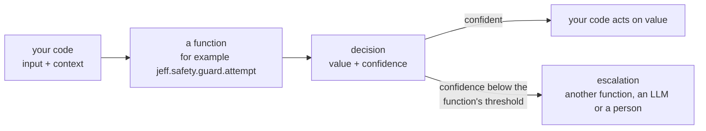

# Introduction

Software often needs a label, a boolean or a level on a scale from a language model. With a generative model,
this requires a structured response, parsing and validation.

**Jeff** is a library of learned **decision functions**. Each function is trained for a specific task, such as
detecting prompt injection or routing a message to a team. It takes an input and, for most functions, a
**context**: fixed facts about the application. It returns a typed **decision** with a selected answer, a
probability for each possible answer and calibrated **confidence**. Jeff does not generate text.

Decisions below the calibrated confidence threshold are marked `abstained`. The caller can use the decision,
raise an error or escalate to another function, a language model or a person. Escalation requires an explicit policy. Over HTTP, the policy is
set once for the whole request, and the server escalates only to other functions; escalation to a language model or
a person runs in the Python SDK, on the decision the server returned. See [Escalation](/docs/guides/escalation).

## Three ways to run a function

- **The HTTP API.** One endpoint, [`POST /v1/decide`](/docs/guides/decide), from any language. It calls named
  functions, lets Jeff pick the function for you (`dispatch`), or runs a [graph](/docs/guides/graphs) of functions
  in one request.
- **`Jeff.remote`**, in the Python package `jeff-sdk` (`pip install jeff-sdk`, imported as
  `jeff`): the same calls from Python, each one made against a Jeff server. See
  [Through the API](/docs/guides/remote).
- **`Jeff.local`**, in the same package: the model runs in your own process, with no server and no network, for
  the lowest latency. It needs the engine package as well (`pip install jeff-sdk jeff-runtime`), and the weights of
  the base model and of each adapter it runs, which are public for every adapter in the catalogue.

The Python code is the same in both modes: bind a function, call it, read `value` and `confidence`.

## The catalogue

Functions are grouped into **adapters**: small sets of extra weights on one shared base model, each trained for one area
(prompt-injection checks, support routing, contract clauses and so on), each with one or more functions. The
[catalogue](/catalogue) lists the adapters, all of them open: their weights are public, so you can call them
through the API or run them yourself with `Jeff.local`.

See [Adapters](/docs/guides/adapters).

## Next steps

- [What are System 1 models?](/docs/guides/system-1): small, fast functions for narrow decisions, and why
  they matter.
- [Quick start](/docs/guides/quickstart): make your first call, on your machine or through the API.
- [Worked examples](/docs/guides/worked-support-agent): four small systems built from Jeff functions, from a
  support agent to CI failure routing, each step a live call.
- [How Jeff works](/docs/guides/how-it-works): functions, interfaces, calibration and adapters.
- [Functions and /v1/decide](/docs/guides/decide): every field in a request and a decision.
- [The catalogue](/catalogue): every function you can call.
- [Roadmap](/docs/guides/gaps): what is not built yet.
