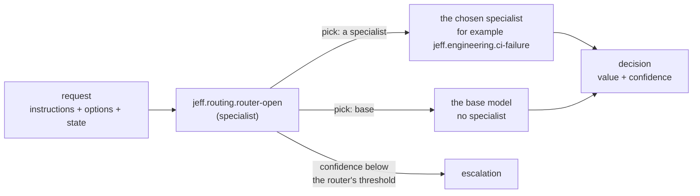

# The swarm

Jeff's open specialists — support, retrieval, reasoning, agents, engineering, safety, language, legal and compliance
— are each trained and calibrated for one narrow kind of decision. A caller whose traffic mixes many kinds of request
does not have to classify each one itself: send the request to a router, `jeff.routing.router-open`, with a menu of
your specialists, and it picks which one should answer. One entry on the menu, `base`, means no listed specialist
fits and the base model should answer the request itself, with no specialist at all.

## Why route instead of calling a specialist directly

A specialist is trained for its own kind of request and is usually more accurate on it than the general base model
answering the same request unprepared. Routing means your integration code does not carry its own if/else logic
mapping request types to functions: it sends one request to the router and gets back which specialist to call, so
adding a specialist or changing which one handles a kind of request is a change to the router's training, not to
your code.

## How well it routes

On 6,930 routing requests held out from its training, with menus of up to 32 entries, the router picks the right
specialist (or `base`) for 99.8% of them, and for 99.5% of the 1,552 whose instructions were reworded.

## Calling it

The router is an open adapter, so you call it through the SDK like any other function: as the input, send the
request's `instructions`, its `options` (the label keys) and its `state` (the specialist's own state — its context
fields and input — as a JSON string), with your menu of specialists as `labels`. Read `value` (the specialist it
picked) and `confidence`, then call that specialist as usual.

### Example: a failed test run

<!-- example: swarm-open-route-ci -->

The router picks `ci-failure` for this failed test run. Its confidence is high, so the caller goes straight to the
specialist it named:

<!-- example: oss-ci-failure -->

`ci-failure` answers `real_regression`: the test fails on every attempt and passes on the main branch, so the change
broke it.

### Example: a retrieval question

<!-- example: more-open-route-evidence -->

Here the router picks `evidence-sufficient`, again with high confidence:

<!-- example: more-evidence-conflicting -->

`evidence-sufficient` answers `conflicting`: the two passages give different warranty terms for the same heat pump,
and nothing says which one is right.

## Low confidence

The router's own decision can abstain, exactly like any other function's: when its confidence falls below its
calibrated threshold, `abstained` comes back `true`. Nothing escalates on its own. A confident `base` pick means you
call the base model yourself instead of a specialist; a low-confidence pick is a separate question — decide what it
means for your traffic with `on_low_confidence` (return it as it is, escalate it to another function, an LLM or a
person, or raise an error), the same way as for any other function. See [Escalation](/docs/guides/escalation).

## The menu

The menu you send the router holds only the specialists you want it to pick between, each as a label key with a
description — the open specialists below, by family. The keys are the adapters' own names:

| Family | Specialists on the menu |
| - | - |
| [Agents](/docs/guides/oss-agents) | `action-check`, `after-result`, `result-relevant`, `task-complete`, `tool-route`, `tools` |
| [Reasoning](/docs/guides/oss-reasoning) | `contradicts`, `entails`, `equivalent`, `is-complete`, `satisfies` |
| [Support](/docs/guides/oss-support) | `message-triage`, `requires-action`, `support-intents`, `triage`, `trading-desk` |
| [Engineering](/docs/guides/oss-engineering) | `ci-failure`, `issue-route` |
| [Retrieval](/docs/guides/oss-retrieval) | `doc-type`, `evidence-sufficient`, `extract-check`, `ground`, `passage-relevant`, `query-route`, `section-id`, `legal-clauses` |
| [Safety and language](/docs/guides/oss-safety-language) | `guard`, `spam`, `emotion`, `sanctions`, `soc` |

Add `base` too, for requests that no listed specialist fits. A menu can hold up to 32 entries, `base` included.

The general-knowledge and assistant-thinking adapters (`knowledge-qa`, `assistant-routing`) are not on the
router's menu: call those directly.

> **Open.** The router runs through the API or on your own machine with `Jeff.local`, like the specialists it
> routes to. Its weights are on Hugging Face, `mstrasser/jeff-adapter-router-open-v14` at revision `v1.4`.

## Pinning a version

The name `jeff.routing.router-open` follows the newest open router only while its interface stays the same: when a
new base is released, the name moves to the new base's router only if that router takes the same request and the
same kind of menu and gives the same kind of answer, so your code keeps working unchanged. A router that changes any
of these gets a new name, and the old name stays with the old router. If you want to keep the router unchanged, call
it by its versioned ID instead, which names the router of one base for as long as the API serves it:

| Name | Versioned ID (base v1.4) |
| - | - |
| `jeff.routing.router-open` | `jeff.routing.router-open-v14` |

Every answer identifies the function used: a decision's `function` names the versioned function that ran
(`jeff.routing.router-open-v14.specialist` for a call to `jeff.routing.router-open.specialist`), so it changes when
the name moves to a new base's router; compare decisions by that if you keep them. A version pin on the unversioned
name (`jeff.routing.router-open.specialist@1.4`) works only until the name moves, and is then refused with
`UnknownFunction`: pin the versioned ID instead. [`GET /v1/functions`](/docs/guides/decide) lists each function's
other names under `aliases`.

## Next steps

- [Escalation](/docs/guides/escalation): what `on_low_confidence` can do with an abstained decision, from the
  router or from any function.
- [Open-source adapters by example](/docs/guides/oss-reasoning): every specialist on the menu above, shown working.
- [Adapters](/docs/guides/adapters): what an adapter is, and what each needs to run.
